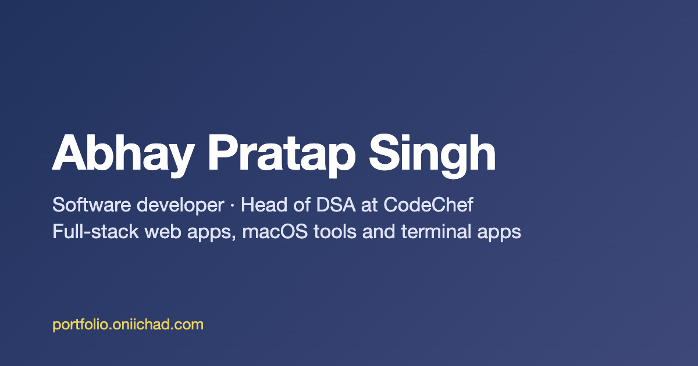

# Abhay Pratap Singh — Portfolio

My personal portfolio: projects, experience, resume and a contact form.

**Live:** [portfolio.oniichad.com](https://portfolio.oniichad.com) · **Blog:** [blog.oniichad.com](https://blog.oniichad.com)



## Features

- Project gallery with descriptions, screenshots, tech tags, and links to the code and live demos
- Experience timeline covering education, hackathons and work
- Contact form backed by Netlify Forms
- Light and dark mode that follows the OS setting and remembers your choice
- Downloadable resume
- Open Graph tags and a sitemap, so shared links get a preview card

## Tech stack

- React 18 with React Router
- Material UI and Emotion
- Formik, Yup and TanStack Query for the contact form
- Hosted on Netlify

## Running locally

```bash
npm install
npm start        # dev server on http://localhost:3000
npm run build    # production build in build/
```

The contact form only delivers messages on Netlify. Locally, submitting it shows an error because there's no form endpoint.

## Updating content

| What | Where |
|---|---|
| Projects | `src/helpers/ProjectList.js` (images go in `public/`, WebP preferred) |
| Experience | `src/pages/Experience.js` |
| Skills and tagline | `src/pages/Home.js` |
| Footer quotes | `src/helpers/QuotesList.js` |
| Resume | `public/Abhay Pratap Singh.pdf` |

When you add a project, also add its `/project/<index>` URL to `public/sitemap.xml`.

## Deployment

Netlify builds and deploys every push to `master`. `public/_redirects` sends all routes to `index.html` so client-side routes work on refresh.
